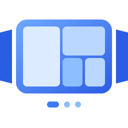
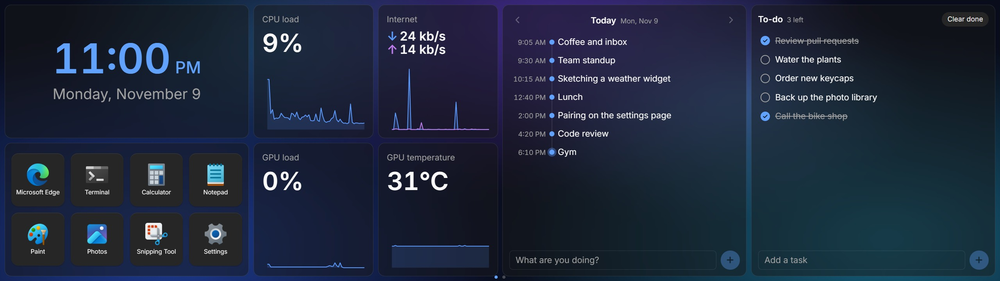
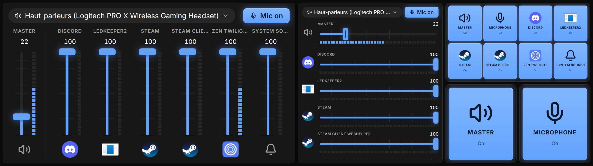
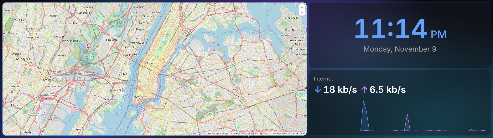

<div align="center">



# EdgeStation

**Give your second screen something to do.**

A widget dashboard for your secondary display.<br />
Made for the Corsair Xeneon Edge. Works on any display.

[](https://github.com/chainlist/edgestation/releases/latest)
[](https://www.npmjs.com/package/@edgestation/sdk)
[](https://github.com/chainlist/edgestation/actions/workflows/release.yml)
[](https://chainlist.github.io/edgestation/download)

[**Download**](https://github.com/chainlist/edgestation/releases/latest) · [Website](https://chainlist.github.io/edgestation/) · [Widget docs](https://chainlist.github.io/edgestation/docs) · [Changelog](CHANGELOG.md)

</div>

<br />

<p align="center">
	
	<br />
	<sub>A real screenshot of a Xeneon Edge, 2560 × 720 pixels.</sub>
</p>

## What is EdgeStation?

EdgeStation fills a secondary display with swipeable pages of widgets: the time, how hard your PC is working, what's playing, your to-dos, app shortcuts and whole web pages. It stays full screen on that display all day, and you set it up from its icon in the notification area.

In the app, the display it runs on is called **the Edge**: a Corsair Xeneon Edge (a 2560 × 720 touchscreen), or any other monitor you give it.

- **Pages on a grid.** Each page is its own grid. Add widgets, drag one to move it, drag a corner to resize it, and the Edge follows as you go. Place a widget as often as you like, each copy with its own settings.
- **Any web page as a widget.** The URL and YouTube widgets show sites in a native browser view, so even sites that refuse to be embedded work. Browser profiles keep separate sign-ins, so your work calendar can sit next to your personal one.
- **Every app's volume.** Faders with live level meters for the master, your microphone and each app that plays sound, or mute buttons only.
- **Make it yours.** Dark or light, an accent color, the corner radius, a background image and frosted glass cards. Widgets follow the theme too.
- **Any display.** The first secondary display, or the one you pick. Any size, shape or orientation, with or without touch.
- **Touch, mouse or keys.** Swipe between pages with two fingers, scroll over the page dots, or use shortcuts from any app: <kbd>Ctrl</kbd> <kbd>Alt</kbd> <kbd>Page Up</kbd> / <kbd>Page Down</kbd> turns pages, <kbd>Ctrl</kbd> <kbd>Alt</kbd> <kbd>G</kbd> goes to a page by name.
- **A widget marketplace.** Settings → Widgets → Browse installs widgets from other people, and keeps them up to date.

<details>
<summary><b>More screenshots</b></summary>
<br />

<br /><br />

</details>

### Built-in widgets

| Widget            | What it shows                                                                                              |
| ----------------- | ---------------------------------------------------------------------------------------------------------- |
| **Clock**         | The time and date, in 12 or 24 hours and the date format you like.                                         |
| **Weather**       | The next 24 hours as a temperature curve over the chance of rain, the temperature now, or today in detail. |
| **Performance**   | CPU or GPU load, GPU temperature, internet usage with averages, the top programs.                          |
| **Media**         | What's playing (Spotify, YouTube, ...) with album art, progress and controls.                              |
| **Mixer**         | Volume faders with level meters, or mute buttons only: every channel, or one per placement.                |
| **Launcher**      | Keys that open apps from the Start menu or the app menu on your main screen, like a Stream Deck.           |
| **To-do**         | A to-do list: type a task, tap it to check it off, clear the done ones.                                    |
| **Logs timeline** | Type what you are doing and it joins a timeline of your day. Browse earlier days.                          |
| **URL**           | Any web page, in a real browser view. Sign-ins last across restarts.                                       |
| **YouTube**       | YouTube, opening on your Subscriptions. Sign in once inside it.                                            |

### Light by design

A dashboard runs all day, so EdgeStation keeps its footprint small.

- **Read on demand.** CPU, GPU and network are read when a widget asks. Nothing monitors in between.
- **Off screen, on hold.** Widget timers wait while their page isn't shown, and while a game is full screen.
- **Contained failures.** Each widget runs within its own boundary. If one fails, the error stays in its tile and the rest keeps running.

## Install

1. Download the installer for your system from the [latest release](https://github.com/chainlist/edgestation/releases/latest): `.msi` or `-setup.exe` on Windows, `.deb`, `.rpm` or `.AppImage` on Linux.
2. Start EdgeStation. It opens full screen on your first secondary display, with a clock on its Home page.
3. Click the EdgeStation icon in the notification area to open Settings (on Linux, choose **Settings** in its menu), then build your pages in **Pages**.

**Windows.** EdgeStation draws its windows with Microsoft Edge WebView2, which comes with Windows 11. The installers have no code signing certificate, so Windows SmartScreen can stop them with "Windows protected your PC". Click **More info**, then **Run anyway**.

**Linux.** EdgeStation runs on X11 desktops, and Wayland sessions run it on XWayland. It draws its windows with WebKitGTK 4.1. The mixer works with PulseAudio, or PipeWire with pipewire-pulse. The Media widget reads players through MPRIS, and the Wi-Fi name comes from NetworkManager. The tray icon needs an app indicator host. On a desktop without one, start EdgeStation again to open Settings. The AppImage needs libfuse2, which recent distributions no longer install by default (on Ubuntu 24.04, `libfuse2t64`).

GPU load and temperature need an NVIDIA GPU and its driver; everything else works without one. Each time EdgeStation opens, it looks for a newer release and asks on the Edge before it installs it, from the same kind of package you installed: the `.msi`, the `-setup.exe`, the `.deb`, the `.rpm` or the AppImage. The `.deb` and the `.rpm` ask for your password to install an update. **Settings → General → Check for updates** looks for a new release at once.

## Write your own widget

A widget is a folder with a `manifest.json` and a JavaScript module, loaded at runtime like a plugin:

```json
{
	"name": "CPU",
	"permissions": ["system"]
}
```

```js
export default {
	mount(el, api) {
		api.every(1000, async () => {
			const { cpu } = await api.system();
			el.textContent = `${Math.round(cpu.load)} %`;
		});
	}
};
```

Write it by hand, or with [`@edgestation/sdk`](packages/sdk/README.md): TypeScript types, adapters for Svelte, React and Vue, a Vite plugin that builds the widget, and a JSON Schema for the manifest.

```bash
npm install -D @edgestation/sdk vite
```

Start with the [widget docs](https://chainlist.github.io/edgestation/docs), or [widgets/README.md](widgets/README.md) in this repository. When your widget is ready, [publish it to the marketplace](https://chainlist.github.io/edgestation/docs/build).

## Develop

EdgeStation is a [Tauri 2](https://v2.tauri.app) app (Rust) with a [SvelteKit](https://svelte.dev) UI, in a pnpm workspace. You need Node.js, pnpm and Rust, and [Tauri's prerequisites](https://v2.tauri.app/start/prerequisites/) for your system. On Linux, that means these packages (Debian and Ubuntu names), as in [the release workflow](.github/workflows/desktop-release.yml):

```bash
sudo apt install libwebkit2gtk-4.1-dev libxdo-dev libpulse-dev libayatana-appindicator3-dev librsvg2-dev
```

```bash
pnpm install       # install the workspace
pnpm tauri dev     # run the app
pnpm check         # type-check every package
pnpm test          # run the unit tests
pnpm tauri build   # build the installers
```

Without a secondary display, the Edge window opens as a normal 1280×360 window on the main screen. In debug builds the built-in widgets are read straight from `widgets/`, and `pnpm tauri dev` rebuilds one whenever its source changes, so editing one only needs Settings → Widgets → Reload Edge.

**Where things are.** [ARCHITECTURE.md](ARCHITECTURE.md) has the repository layout and where each part of the app lives, from the widget runtime to the audio mixer.

**Releases.** Commit messages follow [Conventional Commits](https://www.conventionalcommits.org) (`feat:`, `fix:`). [release-please](https://github.com/googleapis/release-please) keeps a release PR open on `main`. Merging it gives the app and the SDK the same new version, tags `v<version>`, stages the SDK on npm and attaches the signed installers to the GitHub release: the `.msi` and `-setup.exe` for Windows, the `.deb`, `.rpm` and AppImage for Linux. The website deploys after that, because its download buttons link to those files.

## License

The app is licensed under the [GNU General Public License v3.0 or later](LICENSE) (`GPL-3.0-or-later`). You can use, change and share it freely. Anything you distribute that is built from it must be released under the same license, with its source code.

The [widget SDK](packages/sdk/LICENSE) and the [built-in widgets](widgets/LICENSE) are under the MIT License, so widgets built with them can use any license, closed or paid ones included.

The installers also ship [THIRD-PARTY-NOTICES.txt](THIRD-PARTY-NOTICES.txt), the license texts and copyright notices of the third-party code built into the app, which `pnpm notices` writes again after a dependency change.

Copyright (C) 2026 ChainList
